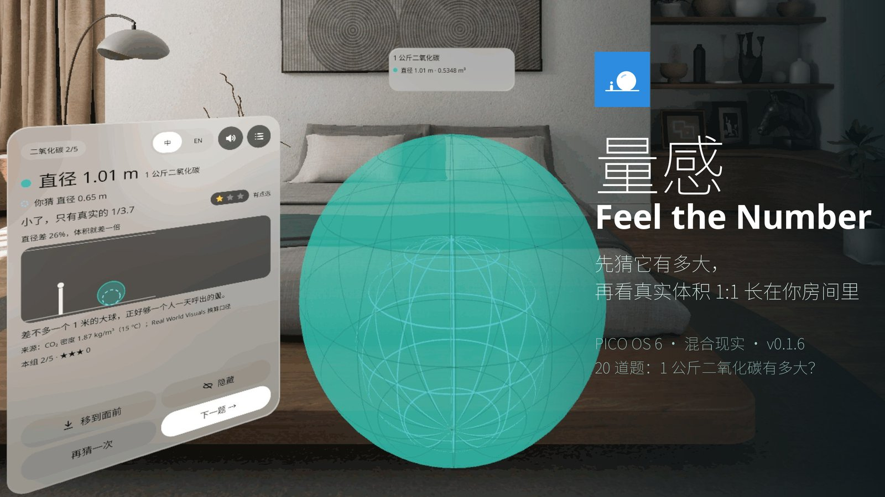
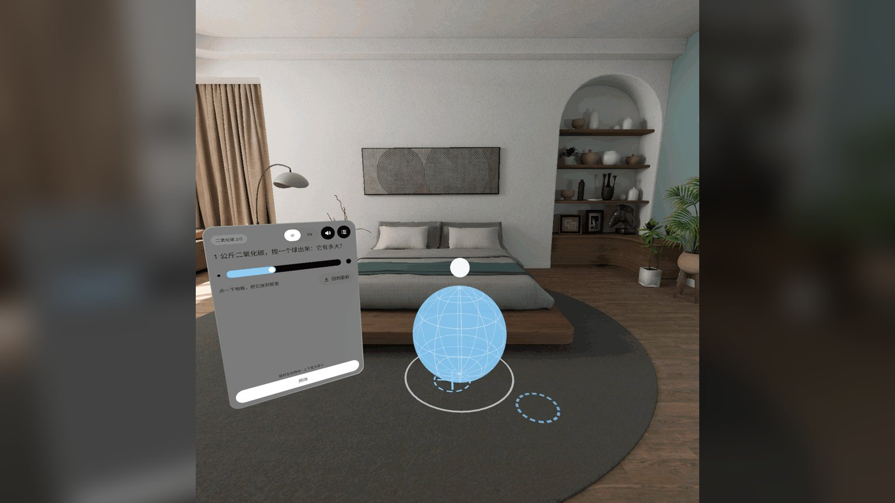
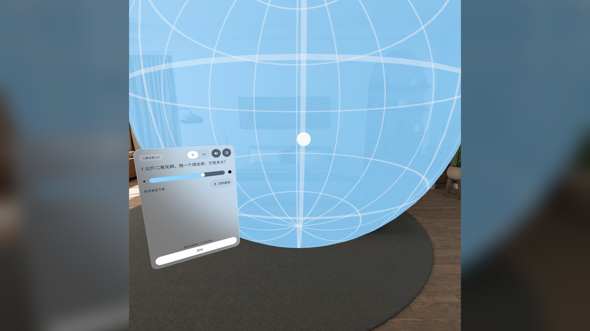
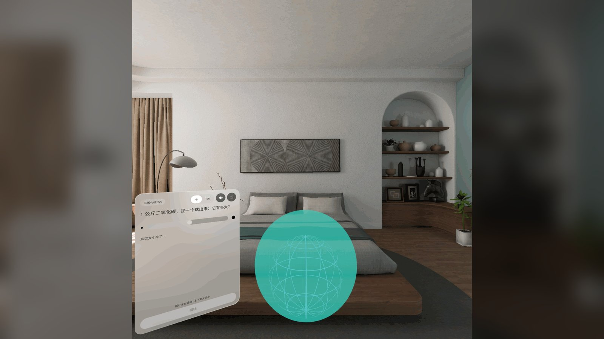
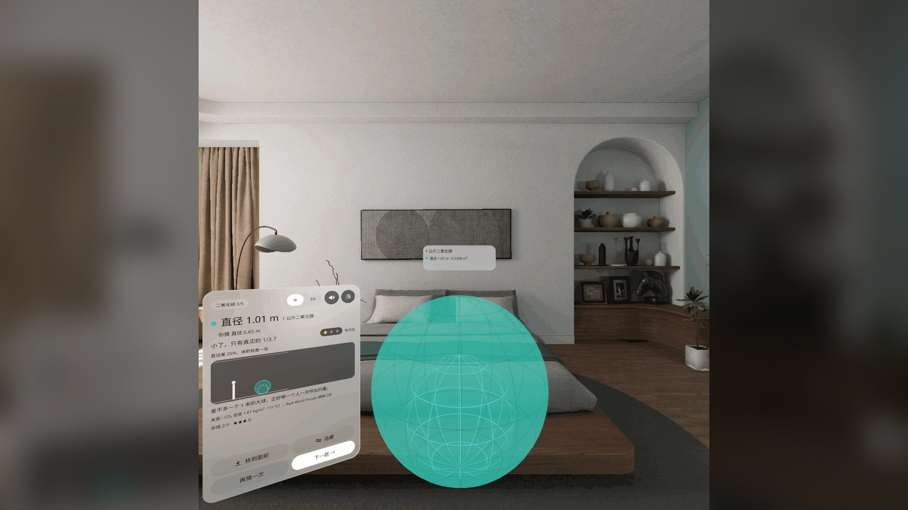
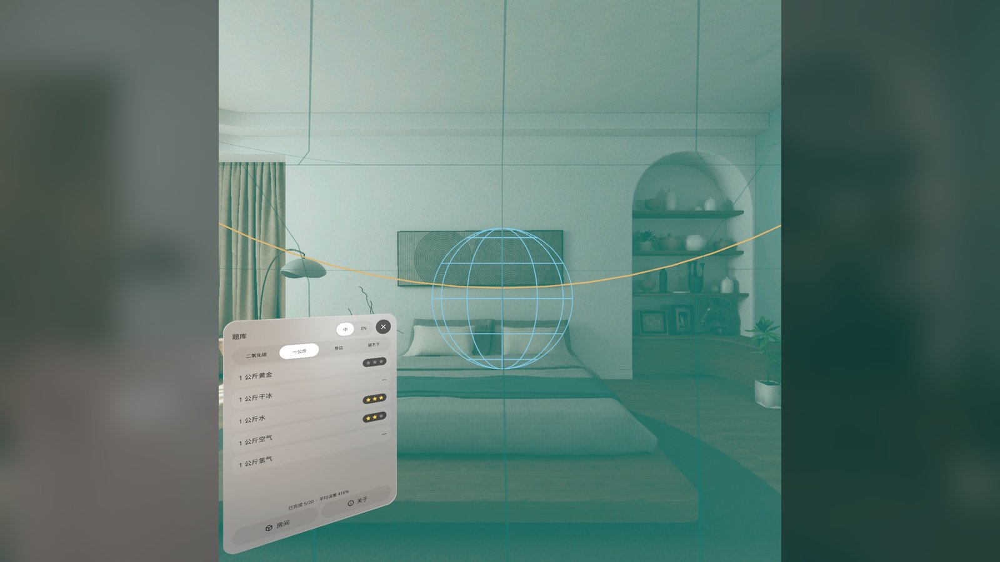
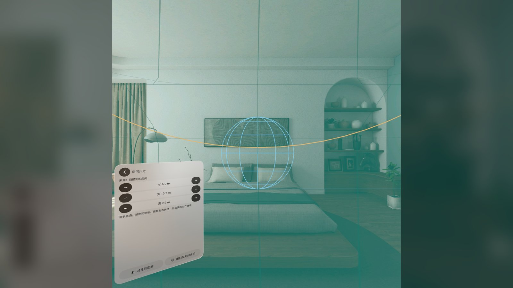

# 量感 · Feel the Number

**先猜它有多大，再看真实体积 1:1 长在你房间里。** PICO OS 6（Swan）混合现实应用，Kotlin + PICO Spatial SDK 6.1.9，一个 Mixed Stage（透视）。
**Guess how big a number really is, then watch the true volume grow life-size in your own room.** A PICO OS 6 (Swan) mixed-reality app, Kotlin + PICO Spatial SDK 6.1.9, one Mixed Stage (passthrough).



| | |
|---|---|
| 包名 / package | `io.embodit.feelnumber` |
| 版本 / version | **v0.1.6**（versionCode 7，commit `2adfad9`） |
| 发布 / release | https://github.com/kejing-dev/FeelTheNumber/releases/tag/v0.1.6 |
| 设备 / device | PICO OS 6 · Spatial SDK 6.1.9 · minSdk 35 · Full Space（Mixed Stage 透视） |
| 语言 / languages | 简体中文 · English（卡片上随时切换） |
| 联网 / network | 不联网、不需要账号 · fully offline, no account |

---

## 中文

### 它是什么

题目说「1 公斤二氧化碳」。你从地板上捏一个球出来，拉到你觉得的大小，点「揭晓」——真实体积从同一个底面、同一个朝向 1:1 长出来，蓝色线框是你猜的，青色实体是真的，卡片告诉你差了多少倍、给几颗星。比房间还大的东西整个画出来（穿墙也画全），「包住我」让你站到它里面去看。

- **20 道题，四组**：二氧化碳（手机充一次电 → 1 吨 CO₂）、一公斤（黄金 3.7 cm 的方块 → 氢气 2.8 m 的球）、身边（一口气、全身的血、一年喝的水…）、装不下（一头蓝鲸、一个标准泳池、中国人均一年的二氧化碳 21 m）
- **真实房间**：平面识别拿到地板、墙和天花板，算「屋里装得下 X%」；扫不到 5 秒自动用 5 × 4 × 2.6 m 的虚拟房间，房间页可调尺寸、对齐真墙
- **输入**：手柄射线 + 扳机，或眼动注视 + 捏合（自动切换）；拉球顶的把手变大，拖球体移动（放哪停哪，可以悬空），摇杆左右转、上下变大变小；地上放一个标记，「移到标记处」把内容搬过去
- **揭晓同一基准**（v0.1.6）：真实体与猜测线框底面中心重合、同一朝向，只差颜色；猜测体悬空就一起悬空，在地上就一起贴地；太大会碰到人时两者一起平移并提示一句
- **设置**：语言、声音、房间、关于，最底下「退出应用」（二次确认后真正退出）
- 灵感来自 Real World Visuals 的真实比例 CO₂ 气泡；数据口径与来源在「关于」页逐题列出

### 截图

> 截图来自 PICO 6.1 模拟器（高清 2560）、中文界面，拍自 v0.1.0–v0.1.2 的 QA 轮次；v0.1.6 在头显上验证，但头显放在桌上时拍不出画面（见「已知情况」）。

| | |
|---|---|
|  猜题页：从地板上捏一个球出来，拉把手定大小；虚线圈是手柄射线落点 |  猜到 3 m：球把你包进去，「松手就定下来」 |
|  揭晓：真实体从猜测体的底面长出来（1.6 s） |  结果页：直径 1.01 m，你猜 0.65 m，「小了，只有真实的 1/3.7」，一颗星；侧视小图画出你和它 |
|  题库：四组 20 题、每题的星数与完成度 |  房间页：长宽高步进、对齐到面前、用扫描到的房间 |

### 安装

```bash
adb install -r FeelTheNumber-v0.1.6.apk
```

```bash
pico-cli app launch io.embodit.feelnumber
```

APK 在 [Release v0.1.6](https://github.com/kejing-dev/FeelTheNumber/releases/tag/v0.1.6)（debug 构建，和头显 PB324XJGL2090081G 上验证过的是同一个包，sha256 见 Release 说明）。

### 版本历史

| 版本 | 日期 | 改了什么（真机反馈 → 改动） |
|---|---|---|
| v0.1.6 | 2026-10-30 | 「绿色答案和蓝色不同起点」→ 真实体与猜测线框同一基准（底面中心重合、同朝向）；设置页 + 退出应用（二次确认）；面板只绕竖直轴朝向用户；控件 ≥ 48 dp；单测 38/38 |
| v0.1.5 | 2026-10-29 | 挑刺站 16 条：问题卡放一次就固定（把手条可拖、离开视野有「叫回」胶囊）；去掉贴墙吸附；离地 10 cm 迟滞；Material 标准图标；状态机单测 |
| v0.1.4 | 2026-10-29 | 「拉那个球之后好像会掉下去」→ 松手停在原处，可悬空；换题从上一题停的位置开始 |
| v0.1.3 | 2026-10-29 | 「点了 reveal 之后就变 2D 了」→ 不再按房间裁切，所有物体整个画出来 |
| v0.1.2 | 2026-10-28 | 「松开后球变成 2D 贴到边上」→ 松手不再外推 |
| v0.1.1 | 2026-10-28 | 「用头显射线放球、球挡住 UI」→ 地面标记 + 「移到标记处」；内容挡住卡片时变淡 |
| v0.1.0 | 2026-10-27 | 首版：20 题、真实 / 虚拟房间、揭晓生长、包住我、中英双语 |

### 已知情况

- **v0.1.6 只做了单元测试（38/38）和头显冒烟（PB324XJGL2090081G：三种揭晓位姿、设置页、退出），没有跑模拟器 QA**——产线两台模拟器当时都被占用。模拟器 QA 最后一轮是 v0.1.2（QA #5 通过）。
- 头显放在桌上时 `screencap` / `screenrecord` 拍不出画面，所以 v0.1.6 没有真机截图；上面的截图是旧版本模拟器 QA 的，结果页上的「移到面前」按钮在 v0.1.1 已改成「移到标记处」，「装不下」题目的切口光环在 v0.1.3 已去掉。
- 演示视频（QA 轮次录的 `FeelTheNumber-demo.mp4`，**非真实手势录像**：调试输入驱动的模拟器录屏）留在另一台产线电脑上，本次没有随发布附上。
- 模拟器里视锥判断偏保守（0.98 m 的球没压住卡片也会变淡）；拖动增益随距离放大，鼠标小幅移动就能把球甩出 2–3 m，真机手感待看。

### 工程

构建、QA 调试广播、目录结构、各版本的头部位姿审查见 [AGENTS.md](AGENTS.md)。设计包、PRD、QA 报告在产线数据目录 `spatial-app-factory/apps/feel-number/`。字体 Noto Sans / Noto Sans SC（SIL OFL 1.1，`third_party/`）。

---

## English

### What it is

A question says "1 kg of CO₂". You pull a ball out of your floor to the size you think it is, tap **Reveal**, and the true volume grows 1:1 from the same base, facing the same way: the blue wireframe is your guess, the teal body is the truth, and the card tells you how far off you were, with up to three stars. Things bigger than your room are drawn whole (through the walls); **Wrap me** puts you inside one.

- **20 questions in four sets**: CO₂ (one phone charge → 1 tonne of CO₂), one kilo (a 3.7 cm cube of gold → a 2.8 m ball of hydrogen), everyday (one breath, all your blood, a year of drinking water…), too big (a blue whale, an Olympic pool, one person's CO₂ for a year, 21 m)
- **Your real room**: plane detection gives the floor, walls and ceiling for "X % fits inside"; no floor within 5 s → a 5 × 4 × 2.6 m virtual room you can size and align
- **Input**: controller ray + trigger, or gaze + pinch (switches automatically). Pull the handle on top to resize, drag the body to move it (it stays where you let go, even in the air), stick left/right to turn and up/down to resize; put a marker on the floor and **Move to marker** carries the content there
- **One base for the reveal** (v0.1.6): the true body and the guess wireframe share the same bottom centre and turn and differ only in colour; a guess left in the air keeps the pair in the air, one on the floor keeps both on the floor; a truth that would reach you moves the pair away together, with a note
- **Settings**: language, sound, room, about, and **Quit the app** at the bottom (confirm, then a real exit)
- Inspired by Real World Visuals' life-size CO₂ bubbles; every question's data and source are listed on the About page

### Screenshots

Taken on the PICO 6.1 emulator (HD 2560) with the Chinese UI during the v0.1.0–v0.1.2 QA rounds; see the captions in the Chinese section above. v0.1.6 was verified on a headset, which cannot be screen-captured while it sits on the desk (see Known issues).

### Install

```bash
adb install -r FeelTheNumber-v0.1.6.apk
```

```bash
pico-cli app launch io.embodit.feelnumber
```

The APK is attached to [Release v0.1.6](https://github.com/kejing-dev/FeelTheNumber/releases/tag/v0.1.6): a debug build, byte-identical to the package verified on headset PB324XJGL2090081G (sha256 in the release notes).

### History

v0.1.6 one base for truth and guess, settings + quit, upright panels · v0.1.5 critic fixes (fixed card with grip and recall, no wall snap, Material icons, state-machine tests) · v0.1.4 it stays where you leave it · v0.1.3 no room clipping · v0.1.2 no push on release · v0.1.1 floor marker instead of head-forward placement · v0.1.0 first build. Details per version: [AGENTS.md](AGENTS.md).

### Known issues

- **v0.1.6 has unit tests (38/38) and a headset smoke test only; it did not go through emulator QA** (both factory emulators were busy). The last emulator QA round was v0.1.2 (QA #5, passed).
- No v0.1.6 screenshots: the headset refuses `screencap` / `screenrecord` while it is not worn. The screenshots above come from older emulator QA rounds; the result page's "In front" button became "Move to marker" in v0.1.1 and the amber cut rings disappeared in v0.1.3.
- The demo video recorded during QA (`FeelTheNumber-demo.mp4`, **not a real-hand recording**: emulator capture driven by debug input) stayed on another factory machine and is not attached to this release.
- The view-cone test is conservative on the emulator (a 0.98 m ball fades without covering the card); drag gain grows with distance, so a small mouse move can throw the ball 2–3 m. Hand feel on the headset still to be judged.

### Project

Build, QA debug broadcasts, structure and the per-version head-pose audits: [AGENTS.md](AGENTS.md). Fonts: Noto Sans / Noto Sans SC (SIL OFL 1.1, `third_party/`).
